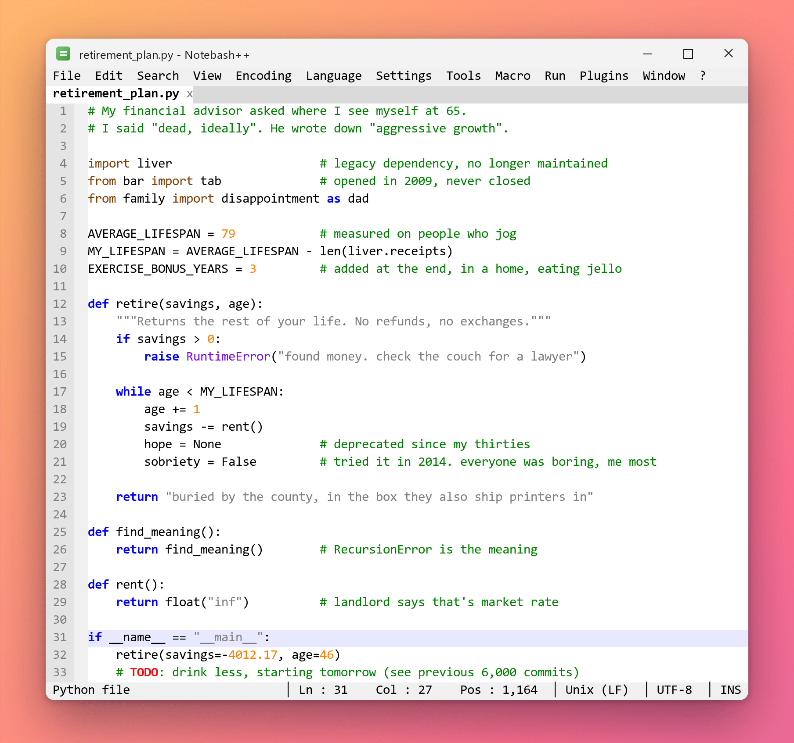
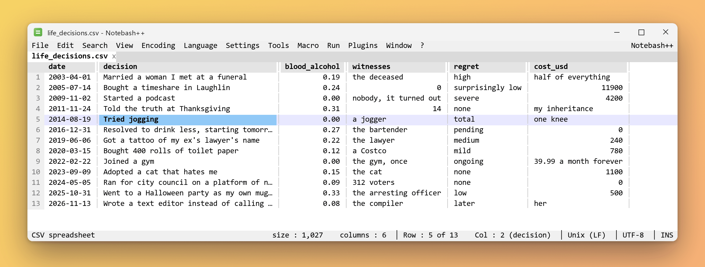
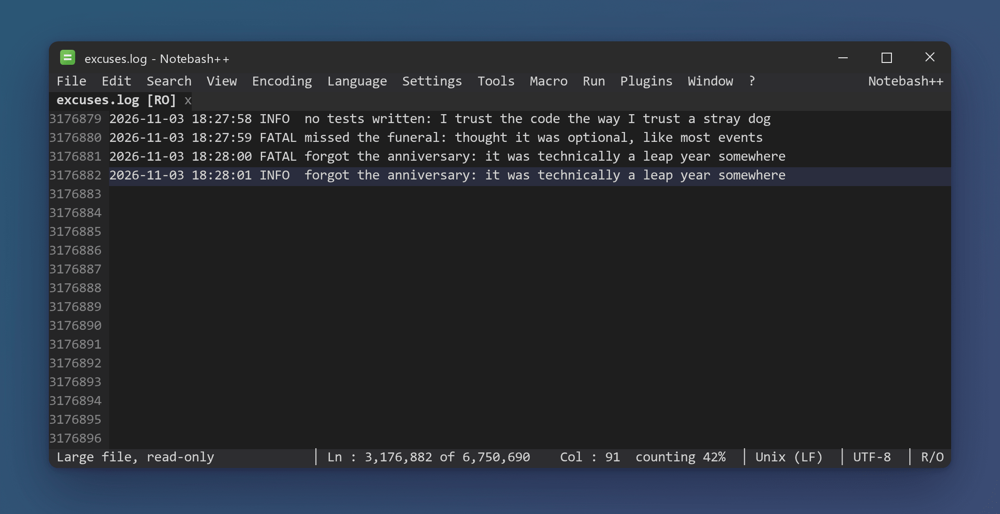
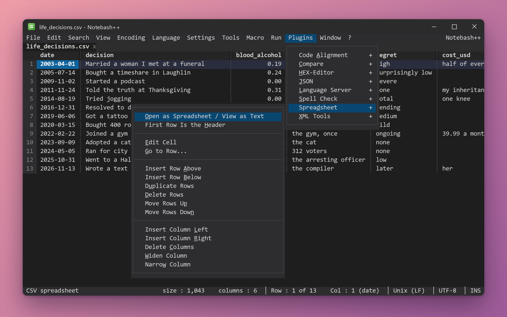
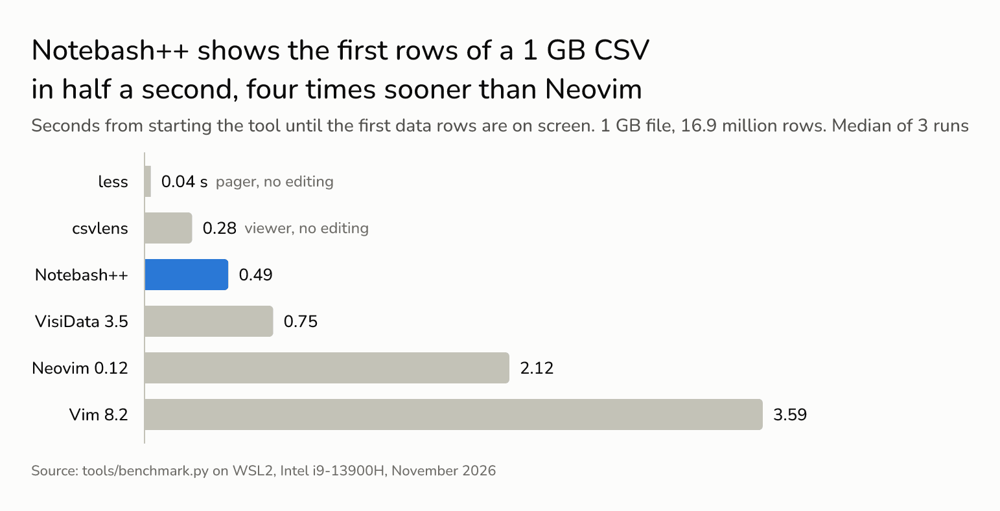
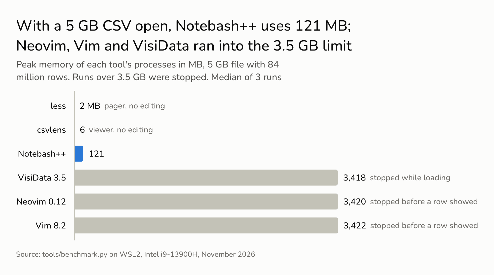

# Notebash++

**Neovim that types and edits like Notepad++.** The same keys, menus and Find
dialog, no modes, on Linux, macOS, WSL and any server you can SSH into.

[](https://github.com/amosWeiskopf/notebash-plus-plus/actions/workflows/tests.yml)




```sh
git clone https://github.com/amosWeiskopf/notebash-plus-plus.git ~/.local/src/notebash-plus-plus
~/.local/src/notebash-plus-plus/bin/nbpp notes.txt
```

No Neovim on the machine? The launcher offers to download it for you
(details under [Install](#install)). There is also a
[128-second video](docs/video/notebash.mp4) of it running, with music; every
line is also a caption, so it works muted.

I have 20 years of Notepad++ in my fingers. Then my work moved to Linux
servers and WSL, and my fingers stayed behind. So this is Notepad++ 8.5.3's
keyboard, copied one shortcut at a time from its source code, running inside
Neovim. Ctrl+S saves, Ctrl+H replaces, Shift+arrows select and typing
replaces the selection. Nobody asks you to learn `ciw` at my age.

## CSV files open as a spreadsheet, at any size



- A 5 GB CSV shows its first rows in 0.72 s and uses 121 MB of
  memory. The rows are counted in a background thread while you already
  scroll; the status bar says how far it got.
- Typing replaces a cell, in any keyboard layout. F2 or a double click
  edits it, Alt+Enter puts a line break inside it, Tab and Enter move on.
- Ctrl+C and Ctrl+V move tab-separated blocks, so pasting to and from Excel
  or Google Sheets works. Ctrl+D duplicates rows, Ctrl+L deletes them,
  Ctrl+Shift+Up/Down moves them, Ctrl+Z undoes.
- Ctrl+S rewrites only the rows you changed. Quoting, line endings and
  number formats everywhere else stay byte for byte as they were, so the
  diff is one line.
- Ctrl+F searches the whole file without loading it, Ctrl+G goes to a row.
  Plugins > Spreadsheet > View as Text shows the raw text when you need it.

### JSON Lines

`.jsonl` and `.ndjson` files open the same way, with one row per line and
one column per top-level key. A 1 GB file shows its first rows in 0.12 s
and peaks at 116 MB of memory.

- The columns are the keys of the first 1,000 lines, in the order they
  first appear. A key that only turns up further down gets a column at the
  right end once its line is on screen.
- Strings show without quotes. Numbers, true, false and null show as
  written, nested objects and arrays as compact JSON. A string that would
  read as another value, like "12", "true" or "", keeps its quotes so you
  can tell it from the number.
- What you type is stored as JSON when it is JSON: 12 is a number, "12" a
  string, [1, 2] an array. Anything else is stored as a string.
- Emptying a cell removes that key from the line. Insert Column asks for a
  key name, and the key is added only to the lines you type it into.
- Ctrl+S rewrites only the lines you changed, and in them only the values
  you changed. Key order, spacing and numbers like 12345678901234567890 or
  1.10 stay as they were.
- A line that is not a JSON object (an array, a number, broken JSON) shows
  its whole text in the first column, with a ! after the row number. It is
  written back untouched unless you edit that text.
- A key that is in the file keeps its column, because deleting it would
  rewrite every line. View as Text does that kind of job.

## 20 GB logs open read-only, at once



Text files over 32 MB open in a view that reads only the lines on screen.
You can scroll, jump to any line (Ctrl+G), search the whole file (Ctrl+F,
F3) and copy what you see. File > Load Whole File for Editing loads files up
to 1 GB the normal way when you really need to change one.

## Type in six places at once


Ctrl+click adds a caret. Ctrl+E selects the next match of the word or
selection, Ctrl+Shift+E all of them (Notepad++ 8.6's Multi-select Next and
All). Then typing, Backspace, Enter, Ctrl+V and the arrows act at every
caret, and one Ctrl+Z takes it all back.

## Web pages and files on your servers

`nbpp` takes a web address or a file on a server as well as a file name:

```sh
nbpp https://example.com/docs/setup.html
nbpp prod:/etc/nginx/nginx.conf
nbpp deploy@web-1:~/site/index.html
```

- A web page asks whether to edit it as HTML or as Markdown. Markdown needs
  [pandoc](https://pandoc.org); without it the page opens as HTML. Any other
  address (a raw file, JSON, a log) opens as the text it is. Ctrl+S asks
  where to save it, because a web server does not take your edits back.
- `host:/path` and `ssh://host/path` open a file over SSH, using your
  `~/.ssh/config` and your keys. Ctrl+S writes it back through a temporary
  file on the server, so the file keeps its owner, permissions and links,
  and a dropped connection never leaves half a file. A name that does not
  exist yet opens empty and Ctrl+S creates it.
- File > Open takes the same addresses.



- **Every Notepad++ 8.5.3 default shortcut**, from the File menu to the
  Scintilla editing keys. [KEYS.md](KEYS.md) lists all of them, and Shift+F1
  then any key tells you what that key does.
- **Find, Replace, Find in Files and Mark** in one dialog with Notepad++'s
  options. Notepad++ (Boost) regular expressions are translated, lookarounds
  and `$1` included. Find in Files uses ripgrep and stops at 10,000 hits.
- **Column mode** (Alt+Shift+arrows, Alt+drag) and the Column Editor.
- **Macros, bookmarks, folding, Compare, word completion, smart
  highlighting**, and the most installed plugins built in: Spell Check,
  JSON, XML Tools, HEX-Editor and Code Alignment.
- **A JSON tree** like the JSON Viewer plugin's: Plugins > JSON > Show JSON
  Tree, or Ctrl+Alt+Shift+J. A panel on the right shows the document as a
  tree with sizes (`users [12]`), and Enter or a click on a line puts the
  caret on that key or value. The line above the tree shows the path of the
  caret, such as `users[3].name`, and Copy JSON Path in the same menu copies
  it. In JSONC documents, comments and trailing commas are accepted. After a
  syntax error the panel names the line and column, and the last good tree
  stays there in grey until you fix it. Documents over 20 MB get no tree.
- **Language servers with no setup**: if `clangd`, `pyright`,
  `lua-language-server` or 11 others are on your path, they start for their
  files. F9 goes to the next problem, Ctrl+F12 to the definition. Servers
  that can run a project's own code (rust-analyzer runs build scripts,
  typescript loads the project's TypeScript, zls runs build.zig, and also
  gopls, pyright and lua-language-server) wait until you choose Plugins,
  Language Server, Trust This Folder, so opening a file from a download
  runs nothing.
- **Session restore**: unsaved documents, carets, scroll positions, folds
  and split windows come back after a restart or a crash.
- **Messages never block typing.** Errors show in a small box that fades;
  there is no "Press ENTER" prompt.
- **Dark mode, word wrap, zoom** (Ctrl+= and Ctrl+-), a word count in the
  status bar, and Ctrl and Alt keys that work with a Hebrew or Arabic layout.

## Measured on big CSV files

<picture>
  <source media="(prefers-color-scheme: dark)" srcset="docs/charts/first-rows-1gb-dark.png">
  
</picture>

<picture>
  <source media="(prefers-color-scheme: dark)" srcset="docs/charts/memory-5gb-dark.png">
  
</picture>

| Tool | Edits and saves | First rows, 1 GB | Last row, 1 GB | Memory, 1 GB | First rows, 5 GB | Memory, 5 GB |
| --- | --- | ---: | ---: | ---: | ---: | ---: |
| **Notebash++** | yes | **0.49 s** | 7.8 s | **111 MB** | **0.72 s** | **121 MB** |
| Neovim 0.12 | yes | 2.12 s | 0.01 s | 1,132 MB | stopped at 3.5 GB | |
| Vim 8.2 | yes | 3.59 s | 0.03 s | 1,118 MB | stopped at 3.5 GB | |
| VisiData 3.5 | yes | 0.75 s | stopped at 3.5 GB | | 1.02 s | stopped at 3.5 GB |
| csvlens | no | 0.28 s | 2.2 s | 6 MB | 0.29 s | 6 MB |
| less | no | 0.04 s | 0.02 s | 2 MB | 0.04 s | 2 MB |

Where it loses, plainly: less and csvlens only show files, and they show them
faster than anything that can also edit. And Ctrl+End in Notebash++ waits
until every row is counted. With the file in the disk cache that runs at
about 1 GB a second; from a cold disk it took 3 to 14 seconds for the 1 GB
file here, and 36 seconds for the 5 GB one.

How it was measured: every tool ran in the same 120 by 30 tmux terminal on
WSL2 (Intel i9-13900H, November 2026). The clock stops when the first data
rows (or the file's last row) are on screen, and peak memory adds up all of
the tool's processes. Each number is the median of three runs; a run over
3.5 GB of memory was stopped. Run it yourself with
`tools/benchmark.py /tmp/benchmark`; it makes the test files, skips tools you
do not have, and prints this table.

## Compared with what you already use

| | Notebash++ | Notepad++ | Neovim or Vim | VS Code |
| --- | --- | --- | --- | --- |
| Linux, macOS, WSL, over SSH | yes | no (Windows, or Wine) | yes | yes, SSH through an extension |
| Runs in a terminal | yes | no | yes | no |
| Notepad++ keys, menus, Find dialog | yes | yes | no | keys only, through an extension |
| No modes, Shift+arrows select | yes | yes | no | yes |
| Plugins to choose from | the popular ones built in | hundreds | thousands | tens of thousands |
| Debugger | no | no | through plugins | yes |
| A 5 GB CSV as a spreadsheet | yes, measured above | not measured | no | not measured |

## What it does not do

- It does not run Notepad++ plugins. The most installed ones are rebuilt
  inside it; for the rest, write Lua or ask.
- A terminal never sends some keys (Ctrl+Shift+letter arrives as
  Ctrl+letter). The Neovide window gets all of them; see
  [Terminals and keys](#terminals-and-keys).
- Neovim has no bidirectional text, so Text Direction RTL mirrors the whole
  window.
- The spreadsheet edits values. It has no formulas, no sort and no filter;
  it is a CSV editor, not Excel, and I am not ready to support your
  accountant.
- The large file view is read-only. Loading a file for editing stops at
  1 GB.
- With several carets, Up and Down move by file line, not by wrapped screen
  row.
- SSH has to log in on its own, with a key or ssh-agent. There is no
  password prompt, and files over 64 MB are refused; copy those over first.
- Windows without WSL works as far as I know, which is not far: the tests do
  not cover it yet.

## Install

You need [Neovim](https://neovim.io) 0.11 or newer; the launcher can
download it for you (below). Optional:
[ripgrep](https://github.com/BurntSushi/ripgrep) for Find in Files,
[pandoc](https://pandoc.org) for web pages as Markdown, and
[Neovide](https://neovide.dev) for every key combination (see below).

Notebash++ runs as its own Neovim configuration (`NVIM_APPNAME=notebashpp`).
Your normal `nvim` and its config are not touched. I have enough to answer
for without destroying the editor you already spent a year configuring.

### Linux, macOS, WSL

```sh
git clone https://github.com/amosWeiskopf/notebash-plus-plus.git ~/.local/src/notebash-plus-plus
mkdir -p ~/.local/bin
ln -s ~/.local/src/notebash-plus-plus/bin/notebash++ ~/.local/bin/notebash++
ln -s ~/.local/src/notebash-plus-plus/bin/nbpp ~/.local/bin/nbpp
nbpp notes.txt
```

`nbpp` is the short name; `notebash++` works the same. If the shell says
`nbpp: command not found`, `~/.local/bin` is not on
your `PATH` (the default on macOS): add `export PATH="$HOME/.local/bin:$PATH"`
to `~/.zshrc` or `~/.bashrc` and open a new terminal.

If `nvim` is missing or older than 0.11, the launcher offers to download
the official Neovim release (pinned, now 0.12.6) from GitHub into
`~/.local/share/notebashpp/neovim`, and checks its SHA-256 before unpacking.
It asks only in a terminal, and the default is no. `notebash++ -installNeovim`
installs it without asking. A system `nvim` that is new enough always wins.
This works on Linux (x86_64 and arm64, glibc) and macOS.

The first start links `~/.config/notebashpp` to the clone. If one instance
is already running, a second `notebash++ file` opens the file in that
instance, as Notepad++ does. Notepad++'s command-line options work:
`-multiInst`, `-nosession`, `-n<line>`, `-c<column>`.
`notebash++ -gui` starts it in Neovide.

### Windows with WSL

After the steps above, `notebash++ -install` puts Neovide in
`%LOCALAPPDATA%\Programs\Notebash++` and adds Notebash++ to the Start menu
and the desktop. The window runs Neovim inside WSL; the clipboard goes
through the bundled `win32yank.exe`, which keeps UTF-8 (Hebrew, Arabic,
emoji) intact.

### Windows without WSL

Clone into `%LOCALAPPDATA%\notebashpp` and run `bin\nbpp.cmd` (or
`bin\notebash++.cmd`, the same thing). If
Neovim is missing or too old, it offers `winget install --id Neovim.Neovim -e`,
or prints the download link when there is no winget. I wrote this path,
but the tests do not cover it yet. Can you please report how it goes?

## Terminals and keys

A terminal cannot send every key Notepad++ uses. Ctrl+Shift+letter arrives
as Ctrl+letter, Ctrl+I as Tab, Ctrl+M as Enter, and terminals and tmux keep
some combinations for themselves. Basically you press a key and several
programs argue over whether you meant it. Neovide passes everything through,
so use it if you want the whole keyboard (I recommend it).

In a terminal, check these:

- **Windows Terminal** takes Ctrl+Shift+Home/End/PgUp/PgDn for scrolling,
  Ctrl+Shift+F, Ctrl+Tab, Alt+Enter and F11. Unbind the ones you want in its
  `settings.json`, for example `{ "id": null, "keys": "ctrl+shift+home" }`
  in `keybindings`.
- **tmux** keeps its prefix key (Ctrl+B by default, Go to Matching Brace in
  Notepad++) and anything you bound with `bind -n`.

## Settings

Copy [user.example.lua](user.example.lua) to `user.lua` in the same folder.
It can:

- give any command other keys (`keys = { rtl = { '<S-F10>' } }`; the ids are
  in [KEYS.md](KEYS.md)),
- add your own commands, listed in the Macro menu,
- make Ctrl+D duplicate whole lines and Delete Current Line act on every
  selected line,
- change the size from which files open in the large file view
  (`large_file_megabytes`), or open CSV and JSON Lines files as text
  (`open_csv_as_spreadsheet = false`),
- change the size limit of the JSON tree (`json_tree_megabytes`, up to 64),
- turn language servers off, all of them (`language_servers = false`) or
  some (`language_servers_off = { 'clangd' }`),
- set any Neovim option.

`user.lua` is ignored by git, so updates leave it alone.

## Where it differs from Notepad++

- Fold Level N (Alt+1 to Alt+8) also opens the levels above N.
- Text Direction RTL mirrors the whole window, because Neovim has no
  bidirectional text: right-to-left text reads correctly, left-to-right
  words inside it read reversed.
- Print (Ctrl+P) prints the text to the default printer through Windows
  Notepad or `lp`, without a print dialog. Please check the default printer
  before giving your mistakes a paper budget.
- Compare uses Neovim's diff view.
- The Find dialog has five Alt keys for buttons that have no letter in
  Notepad++ (listed in [KEYS.md](KEYS.md)).
- Settings > Neovim command line opens the `:` prompt, for everything else
  Neovim can do.

## Hacking on it

The code is Lua in `lua/notebashpp/`, with one module per area
(`keybindings.lua` has every key, `find_and_replace.lua` the dialog,
`notepadpp_regex.lua` the regex translation, `menu_bar.lua` the menus).

A running Notebash++ watches that folder and loads a saved change within
a second, without a restart. Open documents, tabs, Find history, bookmarks
and the recorded macro stay in place. If a file has a syntax error, it is
refused and the old code keeps running. I'd love this arrangement for my
own decisions.

```sh
nvim -l tests/run.lua           # the tests, through Neovim's own input path
bash tools/gen_keys.sh          # rebuild KEYS.md after changing a key
python3 tools/check_comments.py $(git ls-files '*.lua')
```

The tests drive an embedded Neovim with `nvim_input()`, the way Neovide
sends keys. They run in CI on Neovim 0.11, the current stable release and
nightly, so a change in Neovim shows up before users find it.

Comments in this code base are written in lowercase. They can be funny,
provided they stay accurate. `tools/check_comments.py` checks the lowercase
part. The funny part is on the honour system, which is a generous way of
saying I have no test for whether I'm embarrassing myself.

## Citing

If Notebash++ shows up in your paper, thesis or talk, please cite it with
the metadata in [CITATION.cff](CITATION.cff) (GitHub's "Cite this repository"
button gives APA and BibTeX), or:

```bibtex
@software{weiskopf_notebashpp_2026,
  author  = {Weiskopf, Amos},
  title   = {Notebash++: Neovim with the Notepad++ keyboard},
  year    = {2026},
  version = {1.0.0},
  url     = {https://github.com/amosWeiskopf/notebash-plus-plus},
  license = {MIT}
}
```

## License

MIT, see [LICENSE](LICENSE). `bin/win32yank.exe` is win32yank by Rui Abreu
Ferreira under the ISC license, see
[THIRD_PARTY_NOTICES.md](THIRD_PARTY_NOTICES.md). Notebash++ is not
affiliated with the Notepad++ project; Notepad++ is a trademark of Don Ho.
